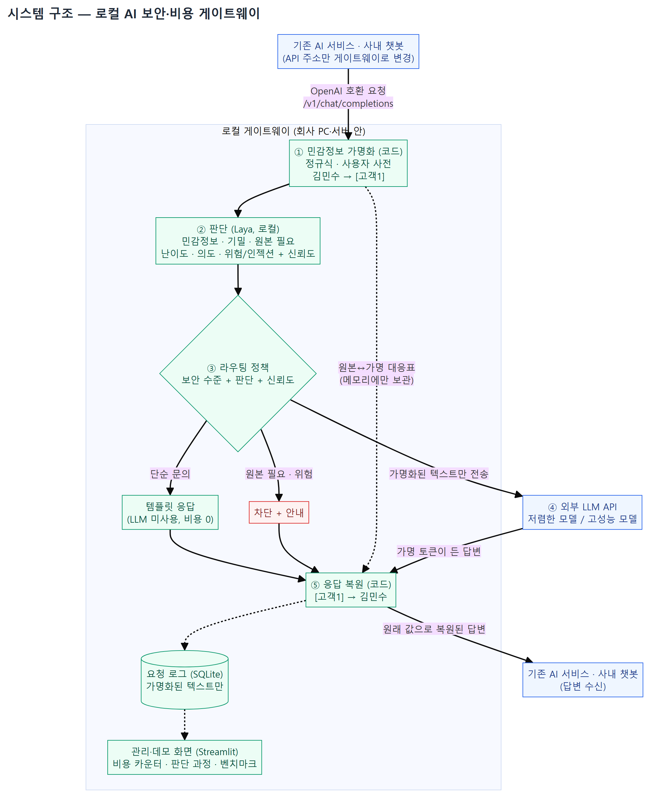
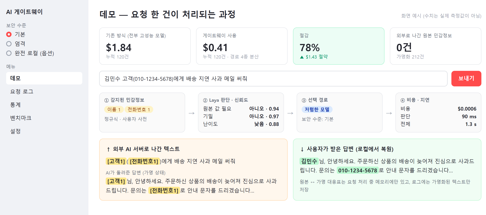

# (가칭) 로컬 AI 보안·비용 게이트웨이

> API 주소 한 줄만 바꾸면 기존 AI 서비스에 개인정보 보호와 토큰 절약이 붙는 로컬 게이트웨이

인공지능프로젝트 수업 개별 프로젝트 · 학과 생성형 AI 경진대회 출품작 · **개발 중**

---

## 1. 프로젝트 개요

### 배경과 문제

기업이 고객센터 챗봇이나 사내 업무에 생성형 AI를 붙이면서 세 가지 문제가 생긴다.

1. **개인정보·기밀 유출**: 고객 이름, 전화번호, 주민번호, 사내 기밀이 요청에 담긴 채 그대로 외부 AI 서버로 전송된다.
2. **비용 낭비**: "배송 언제 와요?" 같은 쉬운 질문까지 비싼 고성능 모델로 보내 비용과 지연이 커진다.
3. **도입 장벽**: 이를 막는 로컬 AI 도구는 무거운 로컬 LLM과 복잡한 설정이 필요해 중소기업이 도입하기 어렵다.

### 목표

| 목표 | 방법 | 확인 방법 |
|---|---|---|
| 민감정보 원본이 회사 밖으로 나가지 않는다 | 가명화 → 외부 전송 → 로컬 복원 | 마스킹 재현율 (놓친 개인정보 비율) |
| 필요한 만큼의 모델에만 보낸다 | 로컬 판단 모델이 난이도·의도를 분류해 경로 선택 | "전부 고성능 모델" 대비 비용 절감률 |
| 설치 한 번, 설정 하나 | 설치 스크립트 + 보안 수준 3단계 중 선택 | 새 PC에서 설치 스크립트로 실행 |

### 대상 사용자

- AI 챗봇·AI 기능을 운영하는 **중소기업·스타트업 개발팀**
- 사내 AI 사용을 관리하는 **보안 담당자**

### 활용 상황

- **쇼핑몰 고객센터 챗봇**: 고객 이름·전화번호가 담긴 문의를 가명으로 바꿔 AI에 보내고, 받은 답변은 원래 값으로 되돌려 전달
- **사내 업무**: 직원이 고객 정보가 든 메일 작성을 AI에 맡겨도 원본은 회사 밖으로 나가지 않음
- **비용 관리**: 단순 문의는 템플릿이나 저렴한 모델로, 복잡한 문의만 고성능 모델로

### 세 가지 강점

| 강점 | 내용 |
|---|---|
| 보안 | 민감정보 원본은 외부로 나가지 않는다. 판단도 로컬에서 한다. |
| 토큰 절약 | 로컬 판단 모델이 요청을 분류해 필요한 만큼의 모델에만 보낸다. |
| 간편함 | 무거운 로컬 LLM 없이 가벼운 판단 모델만 로컬에서 실행한다. 설치 스크립트 하나, 설정은 보안 수준 하나. |

## 2. 핵심 기능과 생성형 AI의 역할

| 기능 | 설명 | 생성형 AI의 역할 |
|---|---|---|
| 민감정보 가명화·복원 | 정규식·사용자 사전으로 감지해 `[고객1]`, `[전화번호1]`로 바꿔 보내고, 답변을 원래 값으로 복원 | **Laya**: 정규식이 놓친 이름·주소, 기밀 수준, 원본 값 필요 여부 판단 / **LLM**: 가명 토큰이 든 요청으로 답변 생성 |
| 요청 판단·자동 라우팅 | 템플릿 / 저렴한 모델 / 고성능 모델 / 차단 중 경로 선택 | **Laya**: 난이도·의도 판단과 신뢰도 / **LLM**: 선택된 모델이 답변 생성 |
| 위험·무관·인젝션 차단 | 위험한 요청, 업무와 무관한 요청, 프롬프트 인젝션 차단 | **Laya**: 위험·무관·인젝션 판단 / **LLM**: 차단 사유에 맞는 안내 문구 생성 (원문 없이 사유만 전달) |
| 비용·판단 과정 화면 + 벤치마크 | 비용 카운터, 단계별 판단 과정, 벤치마크 차트 | Laya 판단·신뢰도 시각화 / **LLM**: 원문 답변 vs 가명화 후 복원 답변 품질 채점 |

**역할 분담 원칙: 판단은 Laya, 생성은 LLM, 마스킹·계산은 코드.** Laya는 판단만 하고 글을 쓰거나 위치를 짚지 못한다. 그래서 실제 치환·복원과 숫자 계산은 코드가 정확하게 처리한다.

## 3. 시스템 구조



| 단계 | 담당 | 하는 일 |
|---|---|---|
| ① 가명화 | 코드 (정규식·사용자 사전) | 전화번호·이메일·주민번호·카드·계좌, 등록된 고객명·사내 고유명사를 가명 토큰으로 치환 |
| ② 판단 | Laya (Ollaya, 로컬) | 민감정보·기밀·원본 필요 여부, 난이도, 의도, 위험·인젝션을 판단하고 신뢰도를 함께 낸다 |
| ③ 라우팅 | 코드 (정책) | 보안 수준 + 판단 결과 + 신뢰도 기준으로 경로 결정. 신뢰도가 낮으면 안전한 쪽으로 |
| ④ 답변 생성 | 외부 LLM API | 가명화된 텍스트만 받아 답변 생성 (저렴한 모델 / 고성능 모델) |
| ⑤ 복원 | 코드 | 답변 속 가명 토큰을 원래 값으로 되돌려 반환 |

- 원본과 가명의 대응표는 **요청 처리 중 메모리에만** 둔다. DB·로그·외부 어디에도 저장하지 않는다.
- 요청 로그(SQLite)에는 가명화된 텍스트, 민감정보 유형·개수, 판단 결과, 경로, 비용, 지연만 남긴다.
- 판단 엔진은 `/v1/systemone` 형식 클라이언트 하나로 감싸서, base URL만 바꾸면 Ollaya(로컬)와 Jev(클라우드, 비교용)를 바꿔 쓸 수 있다.

### 보안 수준 (설정에서 하나만 고른다)

| 수준 | 동작 | 필요 자원 |
|---|---|---|
| 기본 | 가명화 → API 전송 → 로컬 복원. 원본 값이 필요한 요청은 안내 후 차단 | Ollaya만 |
| 엄격 | 기본 + 기밀로 판단되거나 이름·주소가 의심되면 차단 | Ollaya만 |
| 완전 로컬 (옵션) | 민감한 요청은 외부로 보내지 않고 로컬 LLM이 처리 | Ollaya + Ollama |

## 4. 화면 예시 (Streamlit)



> 목업이다. 화면의 수치는 실제 측정값이 아니다.

- **상단 비용 카운터**: "전부 고성능 모델로 보냈을 때"와 "게이트웨이를 썼을 때"의 누적 비용 차이
- **단계별 판단 과정**: 감지된 민감정보 → Laya 판단·신뢰도 → 선택 경로 → 비용·지연
- **좌우 비교**: 왼쪽은 외부 AI 서버로 실제로 나간 가명화 텍스트, 오른쪽은 사용자가 받은 복원된 답변
- **관리 메뉴**: 요청 로그, 통계(경로별 분포·절감액), 벤치마크 차트, 설정(보안 수준·신뢰도 기준·모델)

## 5. 30초 시연 시나리오

1. 설치 스크립트 한 줄 실행 → 게이트웨이 기동
2. 기존 챗봇 설정에서 API 주소만 게이트웨이로 변경
3. "주문한 거 배송 언제 와요?" → 단순 판단, LLM 없이 템플릿 응답 (비용 0)
4. "김민수 고객(010-1234-5678)에게 배송 지연 사과 메일 써줘" → 외부로는 `[고객1]([전화번호1])`, 받은 답변에는 원래 이름·번호
5. "이 주민번호로 고객 나이 계산해줘" → 원본 값이 필요하다고 판단, 안전하게 차단·안내
6. 상단 비용 카운터로 "기존 방식 vs 게이트웨이" 누적 차이 확인

## 6. 기술 스택

| 영역 | 선택 | 이유 |
|---|---|---|
| 언어 | Python 3.11+ | 판단 모델 SDK·벤치마크·파인튜닝 도구와 한 언어로 통일 |
| 게이트웨이 | FastAPI + httpx + pydantic | OpenAI 호환 API 구현 |
| 판단 모델 | Ollaya + Laya 다국어 모델 (로컬) | 가벼움, 판단 결과에 신뢰도 제공 |
| LLM | 저렴한 API 모델 1종 + 고성능 API 모델 1종 | 설정으로 교체 가능 |
| 저장소 | SQLite | 별도 DB 서버 없이 설치 간편 |
| 화면 | Streamlit | Python만으로 데모·관리 화면 |
| 테스트 | pytest | |
| 배포 | 설치 스크립트 (`install.sh`, `install.ps1`) | "설치 한 번" |

9/29 계획(Spring Boot + React, 클라우드 판단 모델 Jev)에서 바꾼 점과 이유는 [docs/decisions.md](docs/decisions.md)에 있다.

## 7. 측정 계획 (벤치마크)

한국어 테스트셋 100문항([data/](data/README.md))으로 측정하고, 결과를 발표 근거로 쓴다.

| 지표 | 내용 |
|---|---|
| 판단 정확도 | 질문별(민감정보·원본 필요·난이도·위험) 라벨 대비 정확도 |
| 신뢰도 보정 | 신뢰도 구간별 실제 정확도 |
| 마스킹 성능 | 민감정보 탐지 재현율·정밀도 (놓친 개인정보가 가장 중요) |
| 답변 품질 | 원문으로 받은 답변 vs 가명화 후 복원한 답변 (LLM 채점 + 일부 수동 확인) |
| 비용·지연 | "전부 고성능 모델" 대비 총비용, 판단 지연 평균·p95 |

## 8. 개발 일정

| 마일스톤 | 기간 | 목표 | 상태 |
|---|---|---|---|
| M0 준비 | 10/11 | 계획 발표 준비, 저장소·이슈 세팅 | ✅ 완료 |
| M0 검증 | 10/26 ~ 10/28 | Ollaya 설치, Laya 한국어 정확도 간이 테스트 | 예정 |
| M1 게이트웨이 핵심 | 10/29 ~ 11/3 | OpenAI 호환 API, 판단·라우팅, LLM 연결, 요청 로그 | 예정 |
| M2 보안 기능 | 11/4 ~ 11/9 | 가명화·복원, 기밀·원본 필요 판단, 보안 수준 3단계 | 예정 |
| M3 측정 | 11/10 ~ 11/11 | 벤치마크, 신뢰도 기준 조정, 파인튜닝 여부 결정 | 예정 |
| M4 화면·설치 | 11/12 ~ 11/14 | Streamlit 화면, 설치 스크립트 | 예정 |
| M5 발표 | 11/15 ~ 11/16 | 시연 녹화, 발표 자료 → 11/17 발표 | 예정 |
| M6 경진대회 | 11/18 ~ 12/1 | 배포·사용자 평가, (조건부) 한국어 파인튜닝 | 예정 |

진행 상황: [Milestones](https://github.com/baesanggue/ai-gateway/milestones) · [Issues](https://github.com/baesanggue/ai-gateway/issues) · [Projects 보드](https://github.com/users/baesanggue/projects/1)

## 9. 설치·사용법

> 설치 스크립트는 M4(11/12~11/14)에 작성 예정

### 개발 실행 (지금)

```bash
uv sync                                                      # 의존성 설치
copy .env.example .env                                       # 키 입력 (커밋 금지)
uv run uvicorn gateway.main:app --host 127.0.0.1 --port 8000 # 게이트웨이 실행
uv run pytest                                                # 테스트
```

### 기존 서비스에 붙이기

기존 서비스의 API 주소만 게이트웨이로 바꾼다. 지금(#7)은 고정 응답을 돌려주며, 판단·라우팅·답변 생성은 M1에서 연결한다.

```python
from openai import OpenAI

client = OpenAI(base_url="http://127.0.0.1:8000/v1", api_key="any-key")
res = client.chat.completions.create(model="gpt-6-luna", messages=[{"role": "user", "content": "주문한 거 배송 언제 와요?"}])
```

- 지원하는 것: `POST /v1/chat/completions` (`stream=false`, 텍스트 content), `GET /healthz`
- 아직 지원하지 않는 것: `stream=true`, 이미지 등 텍스트가 아닌 content (OpenAI 형식 400 오류로 안내)

| 설정 파일 | 내용 |
|---|---|
| `config.yaml` | 보안 수준, 판단 엔진 주소·모델, 신뢰도 기준, LLM 모델. 비밀값 없음 |
| `.env` | API 키 등 비밀값. `.env.example`을 복사해서 만든다. 커밋하지 않는다 |

## 10. 저장소 구조

| 경로 | 역할 |
|---|---|
| `gateway/main.py` | FastAPI 앱 생성 (`create_app`), 오류를 OpenAI 형식으로 바꿔 반환, `GET /healthz` |
| `gateway/config.py` | `config.yaml`(일반 설정)과 `.env`(API 키) 로더. 키는 SecretStr로 감싸 출력되지 않음 |
| `gateway/api/` | OpenAI 호환 엔드포인트 (`/v1/chat/completions`)와 요청·응답 스키마 |
| `gateway/masking/` | 정규식·사용자 사전 기반 민감정보 감지, 가명화, 복원 |
| `gateway/decision/` | 판단 엔진(`/v1/systemone` 형식) 클라이언트, 판단 질문 정의 |
| `gateway/routing/` | 보안 수준·판단 결과·신뢰도로 처리 경로 결정 |
| `gateway/llm/` | 저렴한 모델·고성능 모델 API 클라이언트 |
| `gateway/storage/` | SQLite 요청 로그 (민감정보 원본 미저장) |
| `admin/` | Streamlit 관리·데모 화면 |
| `bench/` | 벤치마크 실행기 |
| `finetune/` | (조건부) 한국어 파인튜닝 |
| `data/` | 테스트셋 (이름·번호는 전부 가상 값) |
| `scripts/` | 설치 스크립트 |
| `tests/` | pytest |
| `docs/` | 설계 결정, AI 활용 기록, 발표 자료, 구조도·화면 목업 |

## 문서

- [설계 결정 기록](docs/decisions.md): 9/29 계획 대비 바뀐 점과 이유
- [AI 활용 기록](docs/ai-log.md): AI에게 맡긴 일과 직접 결정한 것
- [테스트셋 설명](data/README.md)
- [프로젝트 지시서](CLAUDE.md)
