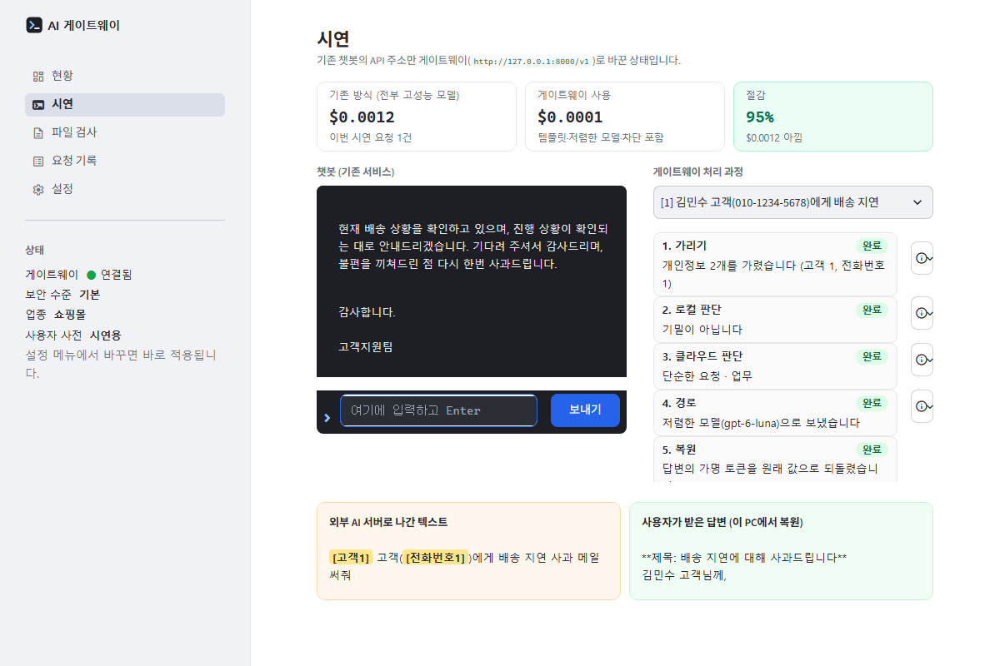
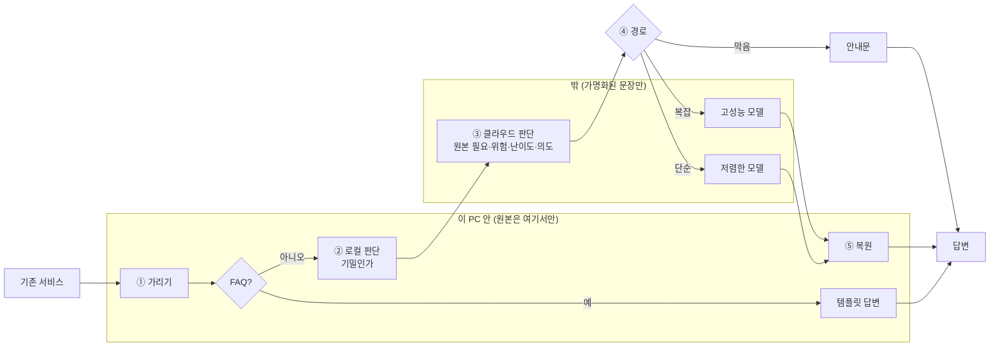
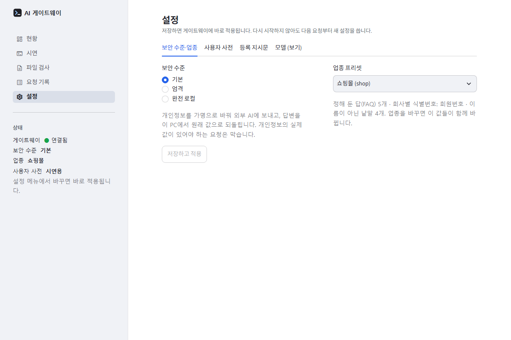

# 가림게이트 (GarimGate) — 로컬 AI 보안·비용 게이트웨이

> API 주소 한 줄만 바꾸면 기존 AI 서비스에 개인정보 보호와 토큰 절약이 붙는 로컬 게이트웨이

인공지능프로젝트 수업 개별 프로젝트 · 학과 생성형 AI 경진대회 출품작 · Windows · Python 3.11+



> 시연 화면. 외부 AI로는 `[고객1]([전화번호1])`만 나가고, 받은 답변은 이 PC에서 원래 이름·번호로 되돌린다. 화면의 이름·번호는 가상 값이다.

---

## 1. 왜 만들었나

기업이 고객센터 챗봇이나 사내 업무에 생성형 AI를 붙이면 세 가지 문제가 생긴다.

1. **개인정보·기밀 유출**: 고객 이름·전화번호·주민번호·사내 기밀이 요청에 담긴 채 외부 AI 서버로 간다.
2. **비용 낭비**: "배송 언제 와요?" 같은 쉬운 질문까지 비싼 고성능 모델로 보낸다.
3. **도입 장벽**: 이를 막는 로컬 AI 도구는 무거운 로컬 LLM과 복잡한 설정이 필요하다.

| 강점 | 어떻게 |
|---|---|
| **보안** | 민감정보 원본은 밖으로 나가지 않는다. 원본을 봐야 하는 판단은 이 PC에서 하고, 밖으로는 가명화된 문장만 보낸다 |
| **토큰 절약** | 판단 모델이 요청을 분류해 템플릿·저렴한 모델·고성능 모델·차단 중 필요한 만큼만 쓴다 |
| **간편함** | 로컬 LLM 없이 가벼운 판단 모델만 CPU로 돈다. 설치 스크립트 하나, 설정은 화면에서 보안 수준 하나 |

**대상**: AI 챗봇·AI 기능을 운영하는 중소기업·스타트업 개발팀, 사내 AI 사용을 관리하는 보안 담당자

## 2. 설치와 실행 (Windows)

**필요한 것**: Windows 10/11, 인터넷(처음 설치할 때), OpenAI API 키, 디스크 약 1.5GB(파이썬 패키지 0.43GB · Ollaya 0.15GB · 판단 모델 0.9GB · 이름 인식 모델 15MB), 메모리 여유 약 3GB. GPU는 필요 없다.

```powershell
git clone https://github.com/baesanggue/ai-gateway.git
cd ai-gateway
powershell -ExecutionPolicy Bypass -File scripts\install.ps1   # 설치 (받을 것을 먼저 보여 주고 확인받는다)
powershell -ExecutionPolicy Bypass -File scripts\start.ps1     # 켜기 → 프로그램 창이 열린다
powershell -ExecutionPolicy Bypass -File scripts\stop.ps1      # 끄기
```

- `install.ps1`은 uv·파이썬 패키지·로컬 판단 서버(Ollaya, CPU용)·판단 모델·이름 인식 모델을 받는다. 모델은 **측정한 버전으로 고정**해서 받고(digest·SHA-256), 다르면 멈춘다. API 키는 입력할 때 화면에 보이지 않고 `.env`(커밋 안 됨)에만 저장된다. 다시 실행해도 된다.
- 처음에는 **시연용 가상 사전**이 들어간다(실제 고객명은 가려지지 않는다). 운영 전에 화면의 [설정 > 사용자 사전]에서 회사의 고객명·직원명으로 바꾼다.
- 단계별 설명: [docs/install.md](docs/install.md). macOS·Linux는 준비 중(#85).

## 3. 기존 서비스에 붙이기

기존 서비스의 **base URL만** 게이트웨이로 바꾼다. 나머지 코드는 그대로다.

```python
from openai import OpenAI

client = OpenAI(base_url="http://127.0.0.1:8000/v1", api_key="local")   # 같은 PC에서는 키를 확인하지 않는다
res = client.chat.completions.create(
    model="gpt-6-luna",
    messages=[{"role": "user", "content": "김민수 고객(010-1234-5678)에게 배송 지연 사과 메일 써줘"}],
)
print(res.choices[0].message.content)    # 외부 AI는 [고객1]·[전화번호1]만 봤고, 답변에는 원래 이름·번호가 들어 있다
```

| 지원 | 내용 |
|---|---|
| `POST /v1/chat/completions` | OpenAI 형식(`stream=false`, 텍스트). 응답 헤더 `x-gateway-request-id`로 요청 기록을 찾는다. 막은 요청은 `finish_reason: "content_filter"`와 안내문 |
| `POST /v1/files/scan` | 파일(PDF·워드·엑셀·텍스트) 속 개인정보 검사와 가명화된 텍스트. 파일은 밖으로 나가지 않는다 |
| `GET /healthz` | 상태 (보안 수준·업종·사전 종류) |
| 아직 안 됨 | `stream=true`(#84), 이미지 등 텍스트가 아닌 내용 → OpenAI 형식 400 오류로 안내 |

- 같은 PC에서 온 요청만 받는다. 다른 PC나 프록시 뒤에서 쓰려면 `.env`에 `GATEWAY_API_KEYS`를 넣고 클라이언트가 `Authorization: Bearer <키>`를 보낸다(D20).

## 4. 어떻게 동작하나



| 단계 | 하는 것 | 누가 |
|---|---|---|
| ① 가리기 | 번호·이메일·주소, 사용자 사전의 이름, 회사별 식별번호, 사전에 없는 이름을 `[고객1]` `[전화번호1]`처럼 바꾼다. FAQ면 여기서 정해 둔 답으로 끝난다(비용 0) | 코드 + 이름 인식 모델 |
| ② 로컬 판단 | 원문을 봐야 하는 판단: 기밀인가 | 판단 모델 (이 PC, CPU) |
| ③ 클라우드 판단 | 가명화된 문장으로 충분한 판단: 원본 값이 필요한가, 위험한가, 난이도, 의도 | OpenAI Decisions |
| ④ 경로 | 보안 수준 + 판단으로 저렴한 모델·고성능 모델·막음을 고른다 | 코드 |
| ⑤ 복원 | 답변 속 가명 토큰을 원래 값으로 되돌린다 | 코드 |

- **역할 분담: 판단은 판단 모델, 생성은 LLM, 가리기·복원·계산은 코드.** 판단 모델은 글을 쓰거나 위치를 짚지 못하므로 실제 치환·복원은 코드가 정확하게 한다.
- 원본 ↔ 가명 대응표는 **요청을 처리하는 동안 메모리에만** 있다. 요청 기록(SQLite)에는 가명화된 문장, 개인정보 종류·개수, 판단·경로·비용·시간만 남는다.
- 판단 순서는 바꾸지 않는다: 가리기 → 로컬 판단 → 클라우드 판단. 엄격 수준에서 기밀이면 클라우드에 보내기 전에 막는다(D12).

### 기능마다 생성형 AI가 하는 일

| 기능 | AI가 하는 일 | 코드가 하는 일 |
|---|---|---|
| 가명화 | 이름 인식 모델이 사전에 없는 이름의 **위치**를 찾는다 | 정규식·사전으로 찾고, 토큰으로 바꾸고, 답변에서 되돌린다 |
| 기밀 판단 (로컬) | 판단 모델이 원문을 보고 "기밀인가"의 확률을 낸다 | 기준값과 비교해 엄격 수준에서 막는다 |
| 라우팅 (클라우드) | Decisions가 가명화된 문장으로 원본 필요·위험·난이도·의도를 판단한다 | 판단 결과로 템플릿·저렴·고성능·차단을 고른다 |
| 답변 | LLM이 **가명 토큰이 든 요청으로** 답을 쓴다 | 토큰을 원래 이름·번호로 되돌린다 |
| FAQ | (쓰지 않음) | 등록된 질문은 정해 둔 답으로 바로 답한다. 밖으로 아무것도 나가지 않는다 |

### 쓰는 모델

| 역할 | 모델 | 어디서 |
|---|---|---|
| 기밀 판단 | `gliclass:v4-edge` (Ollaya, ONNX, 메모리 약 2.2GB) | 이 PC (CPU) |
| 이름 인식 | `koelectra-ko-pii-ner` int8 (14.7MB) | 이 PC (CPU) |
| 원본 필요·위험·난이도·의도 | OpenAI Decisions `gpt-6-luna` | 클라우드 (가명화된 문장만) |
| 답변 생성 | 저렴 `gpt-6-luna` / 고성능 `gpt-6.1-sol` | 클라우드 (가명화된 문장만) |

모델을 고른 과정: [docs/model-evaluation.md](docs/model-evaluation.md), 최종 구성 D25([docs/decisions.md](docs/decisions.md)).

## 5. 화면

프로그램 창(1200×800)으로 열린다. 왼쪽 메뉴는 열고 닫을 수 있다.

| 메뉴 | 내용 |
|---|---|
| **현황** | 처리한 요청, 비용 절감(기존 방식 vs 게이트웨이), LLM 없이 끝난 요청, 가린 개인정보, 경로별 요청·막은 이유 |
| **시연** | 터미널 모양 챗봇 + 요청마다 처리 과정 다섯 단계(가리기 → 로컬 판단 → 클라우드 판단 → 경로 → 복원), 외부로 나간 글 vs 받은 답변 |
| **파일 검사** | 파일을 끌어다 놓으면 개인정보 종류·개수·위치와 가명화된 텍스트 |
| **요청 기록** | 요청 목록과 고른 요청의 처리 과정 (가명화된 문장만) |
| **설정** | 보안 수준·업종 프리셋·사용자 사전·등록 지시문을 바꾸면 **다시 시작하지 않고 바로 적용** |



### 보안 수준

| 수준 | 동작 |
|---|---|
| 기본 | 가명화 → 외부 전송 → 이 PC에서 복원. 개인정보의 실제 값이 있어야 하는 요청(주민번호로 나이 계산 등)은 안내하고 막는다 |
| 엄격 | 기본 + 기밀로 보이는 요청, 가린 뒤에도 주소가 남은 요청을 밖으로 보내기 전에 막는다 |
| 완전 로컬 | 민감한 요청을 이 PC의 LLM이 처리 (준비 중. 지금은 엄격과 같다) |

### 업종 프리셋

업종마다 달라지는 것(FAQ와 정해 둔 답, 회사별 식별번호, 시연용 사전, 이름이 아닌 업무 낱말)을 한 번에 바꾼다: `shop`(쇼핑몰) · `medical`(병원) · `school`(학교). 새 업종 추가: [docs/presets.md](docs/presets.md)

## 6. 측정 결과

한국어 테스트셋 190행(쇼핑몰·사내 100, 의료·금융·공공 각 30, 이름·번호는 전부 가상 값)과 생성 데이터로 쟀다. 측정 PC: Ryzen 7 7800X3D, 32GB, Windows 11, 판단은 CPU만. 전체 표와 출처: [docs/m3-numbers.md](docs/m3-numbers.md)

| 지표 | 값 |
|---|---|
| 개인정보 가명화 | 생성 데이터 **99.5%** (619/622), 테스트셋 **99%** (98/99). 전화·이메일·주민·카드·계좌는 100% |
| 원본 값이 필요한 요청 막기 / 위험·인젝션 막기 | **100%** (18/18, 잘못 막음 0.6%) / **100%** (13/13, 잘못 막음 0%) |
| 경로 정확도 | **89%**, 쇼핑몰(시연 업종) **97%** |
| 비용 절감 | 단순 요청 템플릿 **100%**, 저렴한 모델 **95%**. 전체는 요청 구성에 달렸다(복잡한 요청 10%면 48%, 이 테스트셋은 10%) |
| 판단 지연 (로컬 + 클라우드) | 평균 0.50초, p95 0.65초. 이름 인식은 문장당 2ms |

### 알려진 한계

- 사전에 없는 이름은 99%를 가리지만, 붙여 쓴 이름이나 일반 낱말과 같은 이름은 놓칠 수 있다. 고객명을 사전에 등록하면 100%다.
- 주소는 도로명·지번·건물 이름이 붙은 주소까지 가린다(#87). 시·도나 구 없이 동과 건물 이름만 쓴 주소(`○○동 ○○빌라`)는 놓칠 수 있다.
- 엄격 수준의 기밀 판단은 한 줄 요청 기준 오탐 12%다(막는 쪽으로 틀리게 했다).
- 게이트웨이가 켤 때 판단 모델을 미리 올리고, 마지막 요청 뒤 30분 동안 둔다. 그보다 오래 쉬면 다음 첫 요청이 3~5초 늦다(#84).

## 7. 개발

```bash
uv sync                 # 의존성 (uv.lock 고정)
uv run pytest           # 시험
uv run python -m bench.run_gateway --help   # 벤치마크 실행기 (docs/benchmark.md)
```

| 경로 | 역할 |
|---|---|
| `gateway/api/` | OpenAI 호환 엔드포인트, 같은 PC·게이트웨이 키 확인 |
| `gateway/masking/` | 정규식·사용자 사전·이름 인식 모델로 찾기, 가명화, 복원 |
| `gateway/decision/` | 판단 엔진 클라이언트(로컬 `/v1/systemone`, 클라우드 Decisions), 긴 글 나눠 판단 |
| `gateway/routing/` | 보안 수준·판단 결과로 경로 결정, 차단 안내문 |
| `gateway/llm/` | 저렴한·고성능 모델 클라이언트, 비용 계산 |
| `gateway/storage/` | SQLite 요청 기록 (원본 없음) |
| `gateway/files/` | 파일 속 개인정보 검사 |
| `gateway/pipeline.py` | 한 요청의 전체 흐름 |
| `admin/` | Streamlit 화면 (현황·시연·파일 검사·요청 기록·설정) |
| `bench/` | 벤치마크 실행기와 결과 (`bench/results/`) |
| `config.yaml`, `config/presets/` | 설정과 업종 프리셋. 비밀값은 `.env`에만 |
| `scripts/` | 설치·실행·끄기 스크립트 |
| `data/` | 테스트셋 (가상 값) |

## 8. 일정

| 마일스톤 | 기간 | 상태 |
|---|---|---|
| M0 준비 · 검증 | 10/11, 10/26~10/28 | 완료 (`v0.1-spike`) |
| M1 게이트웨이 핵심 | 10/29~11/3 | 완료 (`v0.2-core`) |
| M2 보안 기능 | 11/4~11/9 | 완료 (`v0.3-security`) |
| M3 측정 | 11/10~11/11 | 완료 (`v0.4-bench`, 11/09) |
| M4 화면·설치 | 11/12~11/14 | 진행 중 (화면·설치 스크립트 완료) |
| M5 발표 | 11/15~11/16 | 11/17 결과물 발표 |
| M6 경진대회 | 11/18~12/1 | 12/2 경진대회 |

진행 상황: [Milestones](https://github.com/baesanggue/ai-gateway/milestones) · [Issues](https://github.com/baesanggue/ai-gateway/issues)

## 사용한 모델·도구 출처

- 이름 인식 모델: [`atonlee/koelectra-ko-pii-ner`](https://huggingface.co/atonlee/koelectra-ko-pii-ner) (가중치 Apache-2.0), 바탕 모델 [`monologg/koelectra-small-v3-discriminator`](https://huggingface.co/monologg/koelectra-small-v3-discriminator)
  - 학습 데이터: `BCCard` openpii, `townboy/korean-pii-dataset` (둘 다 CC BY 4.0)
  - 고정한 커밋과 파일 해시: [docs/ner-model.md](docs/ner-model.md)
- 판단 모델: GLiClass v4 Edge by Knowledgator ([`knowledgator/gliclass-v4-edge`](https://huggingface.co/knowledgator/gliclass-v4-edge), Apache-2.0), [Ollaya](https://github.com/ollaya-dev/ollaya)(Apache-2.0)로 실행
- 클라우드: OpenAI Decisions API, OpenAI Chat Completions API

## 문서

- [설계 결정 기록](docs/decisions.md) — 9/29 계획(Spring Boot·React·Jev)에서 바뀐 점과 이유, D1~D26
- [AI 활용 기록](docs/ai-log.md) — AI에게 맡긴 일과 직접 결정한 것
- [발표용 숫자](docs/m3-numbers.md) · [설치](docs/install.md) · [화면](docs/demo.md) · [테스트셋](data/README.md) · [프로젝트 지시서](CLAUDE.md)
